<p align="center">
  
</p>

<p align="center">
  
  
  
  
  
</p>

<p align="center">
  Real-time detection of driver drowsiness and distraction cues from <b>images, videos and a live webcam</b>, using a fine-tuned <b>YOLOv8m</b> model.<br>
  B.Tech (CSE, AI) final-year project, Jamia Hamdard, 2024.
</p>

<p align="center">
  <a href="#demo">Demo</a> ·
  <a href="#how-it-works">How it works</a> ·
  <a href="#results">Results</a> ·
  <a href="#getting-started">Getting started</a> ·
  <a href="#limitations">Limitations</a> ·
  <a href="docs/Dissertation_Report.pdf">Full report (PDF)</a>
</p>

---

## Demo

<p align="center">
  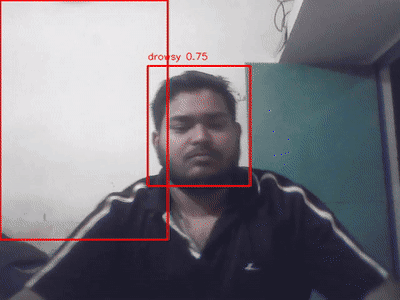
</p>

## What it detects

| Group | Classes | Why it matters |
|---|---|---|
| **Drowsiness cues** | `awake`, `drowsy`, `open_eye`, `closed_eye`, `yawn`, `no_yawn` | Eye state, yawning and head posture are early signs of fatigue |
| **Distraction cues** | `calling`, `chatting`, `drink`, `eating`, `smoking` | Hands-off-wheel and attention-diverting behaviour |

> The validation split contains the six drowsiness classes only, so the metrics below cover those six.

## How it works

**Inference pipeline**

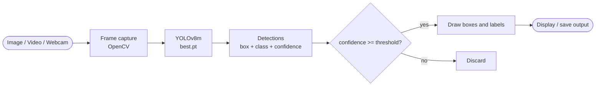

**Training workflow**

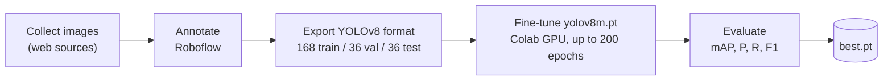

| Item | Value |
|---|---|
| Base model | `yolov8m.pt` (Ultralytics, COCO-pretrained) |
| Epochs / batch / image size | up to 200 / 32 / 640 |
| Dataset | 240 annotated images, 11 classes |
| Training hardware | Google Colab GPU |
| Local inference | Intel i5 10th gen, GTX 1650 Ti (4 GB) |

## Results

<p align="center">
  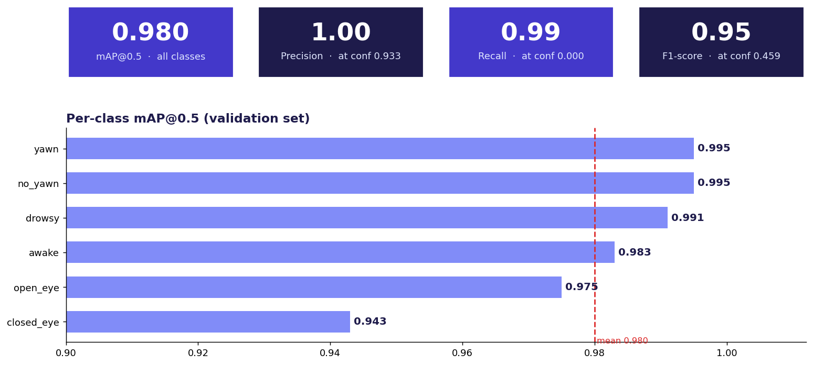
</p>

| Metric | Value | At confidence |
|---|---|---|
| mAP@0.5 (all classes) | **0.980** | n/a |
| Precision | **1.00** | 0.933 |
| Recall | **0.99** | 0.000 |
| F1-score | **0.95** | 0.459 |

*Precision, recall and F1 are peak values read from their respective confidence curves, so each is reported at a different threshold.*

<p align="center">
  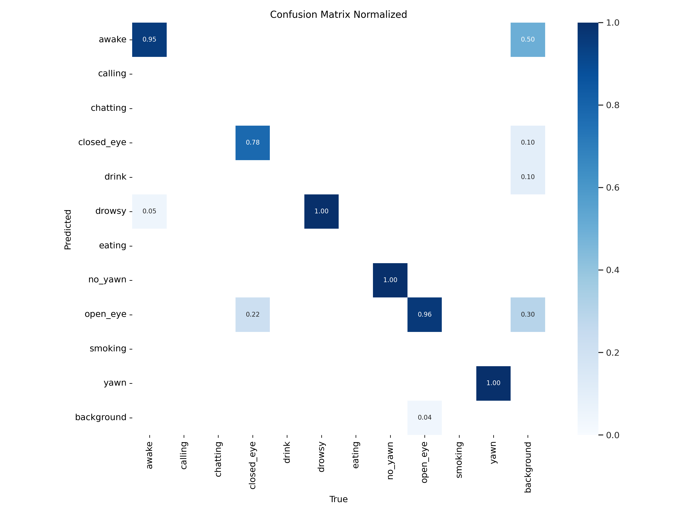
  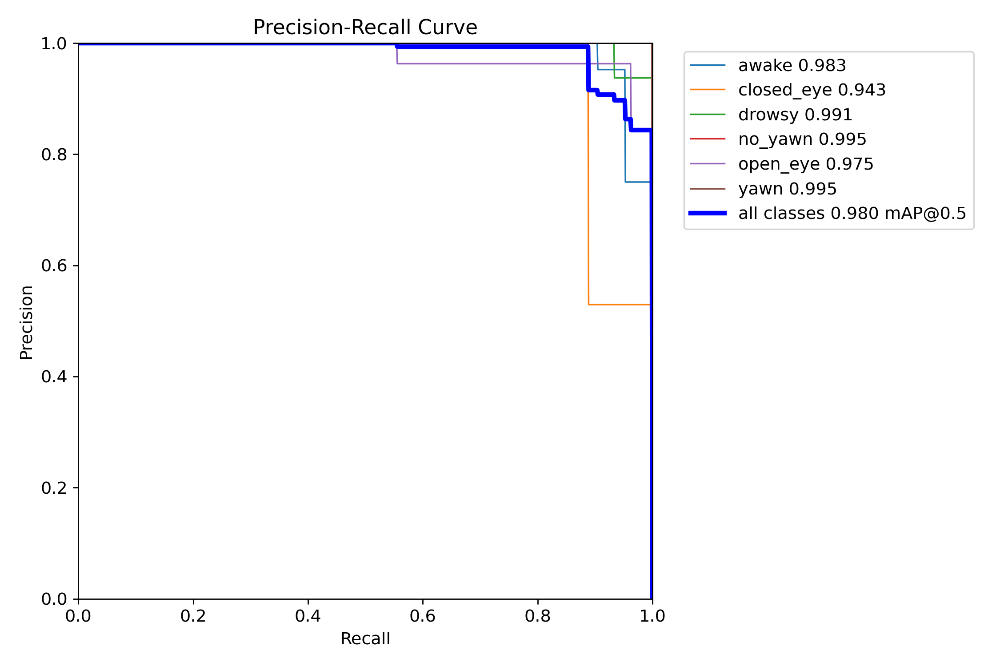
</p>

<details>
<summary><b>More evaluation plots</b> (F1, precision, recall, training curves)</summary>
<br>
<p align="center">
  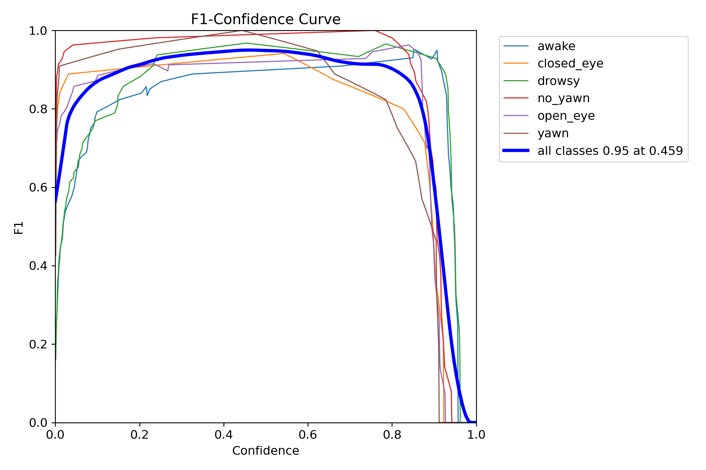
  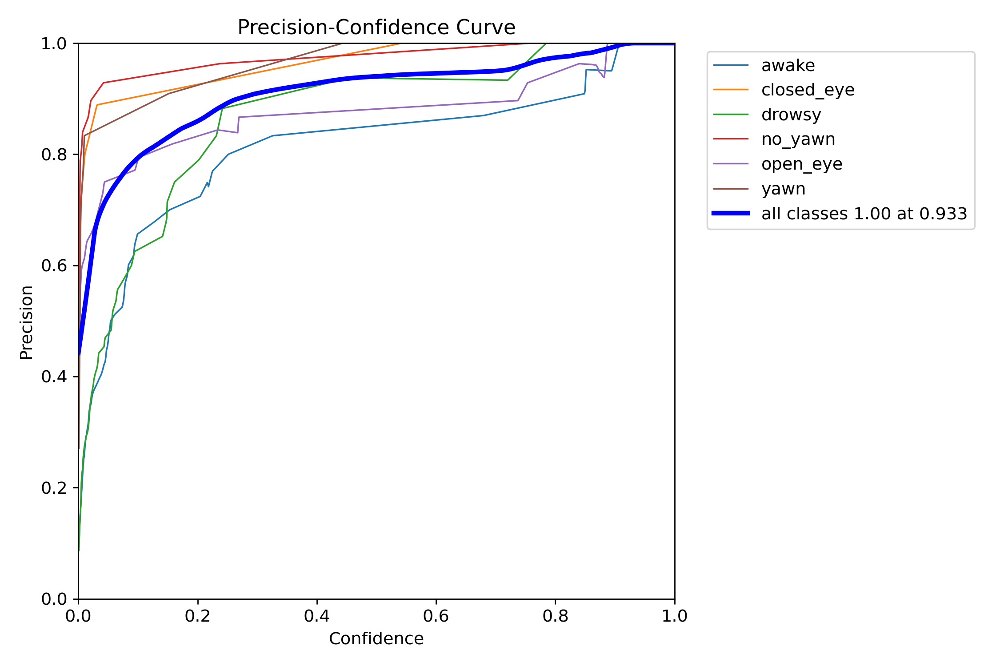
  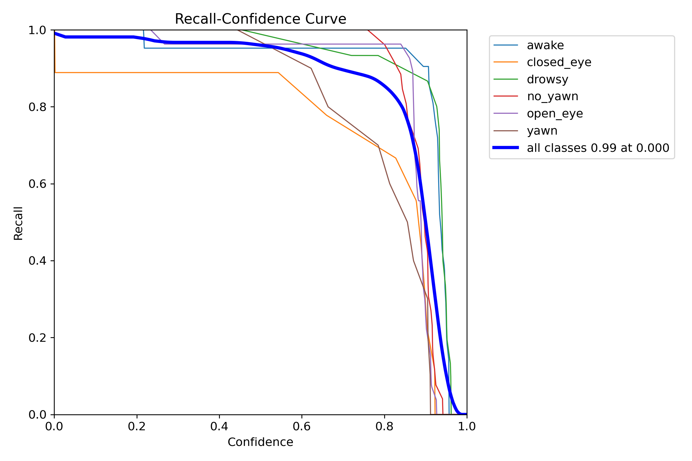
  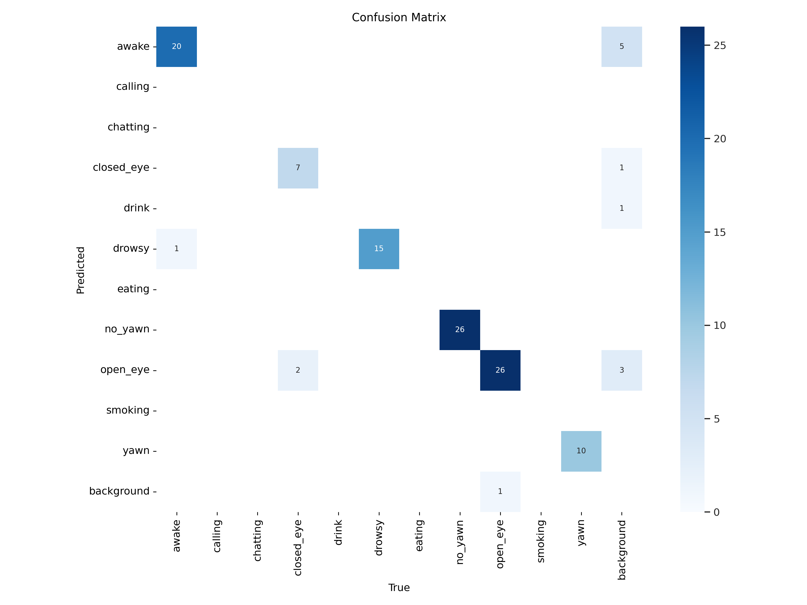
</p>
<p align="center">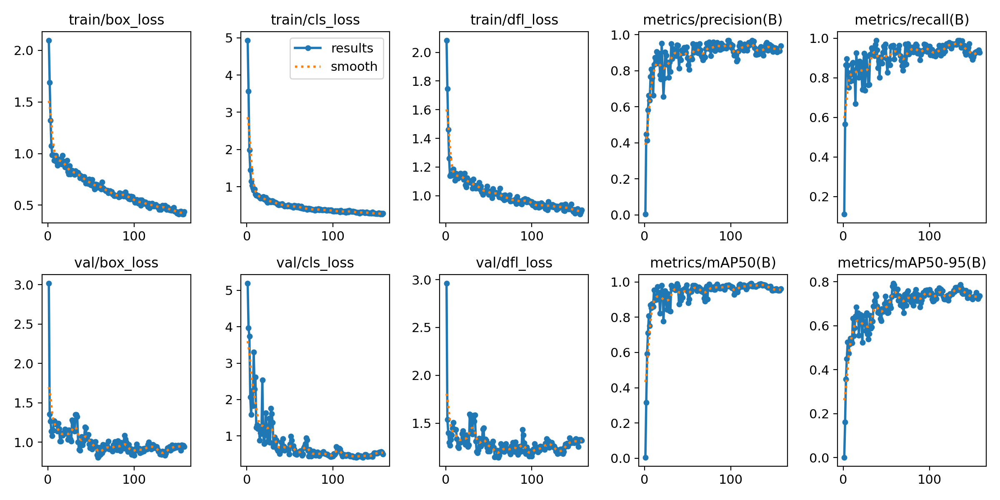</p>
</details>

## Limitations

- **Small dataset** (240 images, 36 for validation), so metrics may overstate real-world performance.
- **Frame-by-frame detection only**: no temporal logic (e.g. eyes closed for N seconds), so alerts depend on single-frame predictions.
- `closed_eye` is misclassified as `open_eye` in ~22% of cases (see normalized confusion matrix).
- Lower confidence on night / infrared video frames, and occasional background false positives (visible in the demo).

## Project Structure

```
driver-drowsiness-detection/
├── README.md
├── LICENSE
├── requirements.txt
├── data.yaml             # dataset config (11 classes)
├── src/
│   ├── detect_image.py
│   ├── detect_video.py
│   ├── detect_webcam.py
│   └── utils.py          # shared drawing / streaming helpers
├── notebooks/
│   └── YOLOv8_training.ipynb
├── weights/              # put best.pt here (download from Releases)
├── assets/               # banner, demo gif, curves, confusion matrices
└── docs/                 # dissertation report
```

## Getting Started

```bash
git clone https://github.com/ALI-ASIF-GIT/DRIVER-DROWSINESS-DETECTION.git
cd DRIVER-DROWSINESS-DETECTION
pip install -r requirements.txt
```

Download `best.pt` from the [Releases](../../releases) page and place it in `weights/`.

```bash
# Image
python src/detect_image.py --source path/to/image.jpg

# Video (press q to quit)
python src/detect_video.py --source path/to/video.mp4

# Live webcam (press q to quit)
python src/detect_webcam.py
```

Common options: `--weights weights/best.pt`, `--conf 0.25`, `--output <path>`. Results are saved to `outputs/` by default.

## Future Work

- [ ] Temporal drowsiness logic (blink duration / PERCLOS) with an audio alert
- [ ] Facial-landmark features (eye aspect ratio) to complement detection
- [ ] Web demo (Flask / Streamlit)
- [ ] Larger, more diverse dataset with proper night-time evaluation
- [ ] Export to ONNX / TFLite for edge deployment

## Author

**Asif Ali** | B.Tech CSE (AI), Jamia Hamdard
[LinkedIn](https://linkedin.com/in/asif-ali-083202208) · [GitHub](https://github.com/ALI-ASIF-GIT)

## License

MIT, see [LICENSE](LICENSE).
